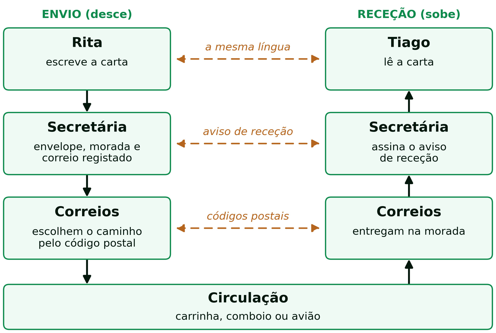
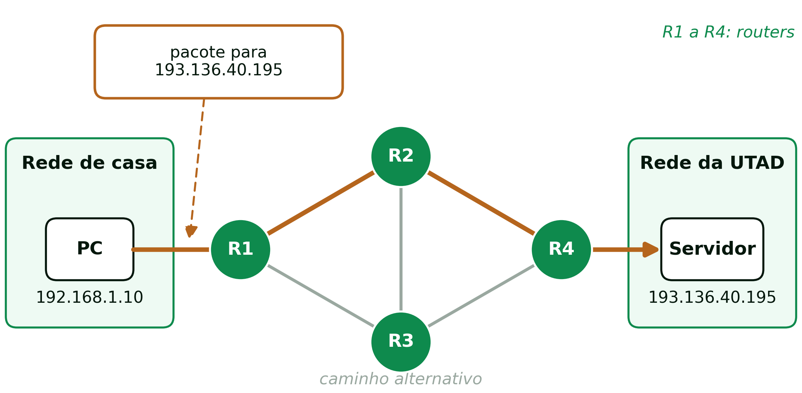

```{=html}
<div class="hero hero-chapter" style="background-image: linear-gradient(to top, rgba(4,23,12,0.88) 0%, rgba(4,23,12,0.6) 20%, rgba(4,23,12,0.15) 45%, rgba(4,23,12,0) 65%), url('../assets/images/heroes/cap06.jpg');">
  <div class="hero-badge">Capítulo 6</div>
  <h1>Modelos de Comunicação e Redes</h1>
</div>
```

## Do PHP à Rede {#sec-06-contexto}

Enquanto desenvolve o site da Contraponto, o Tiago trabalha só do lado do servidor: guarda o catálogo de artigos num *array*, filtra-o por categoria com um `if` dentro de um `foreach` e junta a todas as páginas o mesmo cabeçalho e o mesmo rodapé com `include`. Testa tudo em `localhost`, ou seja, com o *browser* e o servidor no mesmo computador.

A Rita, diretora da revista, faz então uma pergunta simples: «Quando um leitor em Bragança escrever o endereço da Contraponto, como é que a página lhe chega?». Já se sabe que o *browser* envia um pedido e que o servidor devolve HTML. Este capítulo trata do que acontece **entre** os dois.

## O que Ganha um Programador Web em Perceber a Rede? {#sec-06-porque-rede}

Há três razões para um programador web perceber o caminho que cada pedido percorre:

1. **O PHP só chega ao leitor pela rede.** O código pode estar certo, mas a página só aparece se o pedido chegar ao servidor e a resposta voltar.
2. **Para perceber os erros.** «Não foi possível encontrar o servidor» é um problema de nomes. «Ligação recusada» é um problema de porta. Nenhum dos dois é um erro de PHP: saber onde está o problema evita procurá-lo no sítio errado.
3. **Para publicar o site.** Pôr a Contraponto *online* exige um nome de domínio, um endereço IP e as portas 80 e 443.

Quando a Rita ligar a dizer «o site não abre», o Tiago tem de saber responder: o problema está no PHP ou no caminho até ao servidor?

## Porque Organizar a Comunicação em Camadas? {#sec-06-porque-camadas}

Para que um pedido do *browser* chegue ao servidor da Contraponto, são precisas várias operações, cada uma feita por uma parte diferente do sistema. Por exemplo:

1. **Encontrar o servidor:** descobrir o endereço a partir do nome (resolução de nomes);
2. **Garantir uma ligação fiável:** confirmar que nada se perde e que tudo chega pela ordem certa;
3. **Determinar o caminho:** escolher por onde os dados passam, de rede em rede (encaminhamento);
4. **Converter os dados em sinais:** elétricos, luz ou rádio, a cargo da placa de rede.

Só a primeira começa no *browser*. As outras são feitas pelo sistema operativo, pelos *routers* e pela placa de rede. Fica então uma pergunta: como é que equipamentos de fabricantes diferentes, espalhados pelo mundo, fazem estas operações todos da mesma maneira?

### O que é um Protocolo? {#sec-06-protocolo}

A resposta está nos protocolos. Um **protocolo** é um conjunto de regras acordadas entre dois dispositivos que comunicam à distância. Define:

- o **formato** das mensagens;
- a **ordem** em que são trocadas;
- o que fazer quando **algo corre mal**.

Funciona como um **contrato** entre os dois dispositivos.

Nenhum protocolo resolve sozinho todo o envio de uma mensagem. Usam-se vários, cada um responsável por uma das operações acima, empilhados uns sobre os outros: **os de cima usam os de baixo**. A este conjunto chama-se **pilha protocolar** (*protocol stack*). Cada nível desta pilha chama-se **camada**; daí o nome **arquitetura em camadas**. Cada camada usa os serviços da camada inferior e oferece os seus serviços à camada superior.

### Exemplo: as Camadas no Envio de uma Carta {#sec-06-carta}

O envio de uma carta pelo correio está organizado da mesma maneira. A Rita quer enviar uma carta ao Tiago. Escreve-a e entrega-a à secretária, que a mete num envelope, escreve a morada e a envia em correio registado, com aviso de receção. Os Correios escolhem o caminho pelo código postal, e a carta viaja de carrinha, de comboio ou de avião. Do lado do Tiago, o percurso faz-se ao contrário: os Correios entregam a carta na morada, a secretária do Tiago assina o aviso de receção e entrega-lhe a carta, e o Tiago lê-a (@fig-06-carta).

{#fig-06-carta width="85%"}

Neste exemplo, cada camada faz uma das quatro operações descritas acima:

1. **Encontrar o servidor:** equivale a Rita procurar a morada do Tiago na agenda;
2. **Ligação fiável:** equivale a secretária pedir aviso de receção e, se este não chegar, enviar a carta outra vez;
3. **Caminho:** os Correios escolhem-no usando mapas e códigos postais;
4. **Sinais:** a circulação propriamente dita; a carrinha, o comboio ou o avião levam a carta de um ponto ao outro.

A Rita não sabe se a carta foi de carrinha ou de avião, e o motorista nunca a lê. Se os Correios trocarem a carrinha por um drone, nem a Rita, nem as secretárias, nem o Tiago têm nada a ver com isso. **É esta independência que dá valor às camadas:** cada camada pode ser melhorada ou substituída sem mexer nas outras, desde que continue a prestar o mesmo serviço à camada de cima.

### Serviço e Protocolo {#sec-06-servico-protocolo}

A figura da carta mostra dois tipos de relação, que convém distinguir:

- **Protocolo:** regras entre a **mesma camada** em dois dispositivos diferentes (as chamadas **camadas pares**). As duas camadas pares seguem as mesmas regras e entendem-se **à distância**. Na @fig-06-protocolo-servico, são as setas horizontais.
- **Serviço:** o que uma camada oferece à **camada imediatamente acima**, dentro do **mesmo dispositivo**. A camada de cima usa esse serviço sem precisar de saber como funciona por dentro. Na @fig-06-protocolo-servico, são as setas verticais.

Em resumo, um protocolo tem uma ação remota e um serviço tem uma ação local. Na carta, a secretária da Rita **usa o serviço** dos Correios: entrega-lhes a carta e não quer saber como chega. Mas **segue um protocolo** com a secretária do Tiago, sem nunca falar com ela: pede aviso de receção, e a outra sabe que tem de o assinar e devolver, porque é essa a regra combinada.

{#fig-06-protocolo-servico width="70%"}

## Os Dois Modelos: OSI e TCP/IP {#sec-06-osi-tcpip}

Historicamente, surgiram dois modelos de referência para organizar a comunicação em camadas, com origens diferentes.

### O Modelo OSI {#sec-06-osi}

O modelo **OSI** (*Open Systems Interconnection*) é um modelo formal com **sete camadas**, criado pela ISO (*International Organization for Standardization*), o organismo internacional de normalização. De cima (7) para baixo (1):

- **Aplicação (7):** onde trabalham os protocolos que os programas do utilizador usam (HTTP, SMTP, FTP);
- **Apresentação (6):** põe os dados num formato que os dois lados entendem (codificação, compressão, cifragem);
- **Sessão (5):** abre, mantém e fecha a conversa entre os dois lados;
- **Transporte (4):** entrega os dados ao programa certo, com ou sem garantia de entrega (TCP, UDP);
- **Rede (3):** escolhe o caminho entre redes diferentes (IP);
- **Ligação de Dados (2):** entrega os dados a outro equipamento da mesma rede local (Ethernet, Wi-Fi);
- **Física (1):** transforma os bits em sinais elétricos, luz ou rádio.

O OSI é um padrão ***de jure*** (do latim, «por lei»): foi definido formalmente por um organismo de normalização antes de estar em uso generalizado.

### O Modelo TCP/IP {#sec-06-tcpip}

O modelo **TCP/IP** nasceu da prática, na ARPANET, a rede criada nos anos 60 pelo Departamento de Defesa dos EUA que deu origem à Internet. É mais simples do que o OSI: tem só **quatro camadas**.

- **Aplicação:** os protocolos que os programas usam diretamente (HTTP, SMTP, FTP, DNS);
- **Transporte:** entrega os dados ao programa certo no computador remoto, usando o protocolo **TCP** (*Transmission Control Protocol*), que confirma que todos os dados enviados chegam ao destino, ou o **UDP** (*User Datagram Protocol*), mais rápido, mas sem essa confirmação;
- **Rede (ou Internet):** encaminha os dados entre redes diferentes, com o protocolo **IP** (*Internet Protocol*). Chama-se «Internet» porque é a camada que liga as redes entre si (o nome vem de *internetwork*, interligação de redes);
- **Acesso à Rede:** entrega os dados na rede local e transmite-os no meio físico (Ethernet, Wi-Fi).

O TCP/IP é um padrão ***de facto*** («na prática»): impôs-se pelo uso generalizado, antes de qualquer normalização formal. É o modelo que a Internet usa.

### OSI e TCP/IP Lado a Lado {#sec-06-lado-a-lado}

A @tbl-06-osi-tcpip resume as diferenças entre os dois modelos.

|                | Modelo OSI                    | Modelo TCP/IP              |
|----------------|-------------------------------|----------------------------|
| Camadas        | 7                             | 4                          |
| Origem         | ISO, organismo de normalização | ARPANET, nasceu da prática |
| Tipo de padrão | *de jure*                     | *de facto*                 |
| Uso hoje       | referência e ensino           | é o que a Internet usa     |

: As diferenças entre os modelos OSI e TCP/IP. {#tbl-06-osi-tcpip}

A @fig-06-modelo-osi mostra a correspondência: as três camadas de cima do OSI juntam-se na camada de **Aplicação** do TCP/IP, e as duas de baixo no **Acesso à Rede**. O OSI continua a ser ensinado porque separa melhor as responsabilidades de cada camada. A um programador web interessam sobretudo três camadas do TCP/IP: a de aplicação, onde trabalha o HTTP; a de transporte, com o TCP; e a de rede, com o IP.

{#fig-06-modelo-osi width="45%"}

::: {.callout-note}
Para ver que outros protocolos reais correm em cada camada, e o formalismo mais preciso por trás da distinção entre serviço e protocolo, ver a @sec-apD-protocolos-camada e a @sec-apD-servicos-protocolos.
:::

## O Percurso dos Dados: Encapsulamento {#sec-06-encapsulamento}

A @fig-06-emissao-nic mostra o caminho que os dados de um pedido percorrem dentro do computador, de cima para baixo:

1. O *browser* (o retângulo **DADOS**) traduz os seus pedidos (por exemplo, o de uma página) numa mensagem de texto, de acordo com as regras de um protocolo chamado HTTP;
2. Entrega essa mensagem ao ***socket***: o ponto de ligação entre o programa e as camadas de baixo;
3. A mensagem desce as camadas de transporte, rede e ligação, e cada uma acrescenta um cabeçalho com a sua informação, de acordo com as regras do seu protocolo;
4. Chega à **placa de rede** (NIC, *Network Interface Controller*), que a converte em sinais elétricos ou de rádio.

{#fig-06-emissao-nic width="55%"}

::: {.callout-note}
Não confundir a **camada de aplicação** (uma camada do modelo TCP/IP) com a **aplicação** (o programa que o utilizador usa, como o *browser*).
:::

Ao descer, cada camada acrescenta aos dados um **cabeçalho**: um bloco com a informação de que a camada par, no outro dispositivo, vai precisar para fazer o seu trabalho. A este processo chama-se **encapsulamento**:

1. **Camada de Aplicação:** produz os dados (a mensagem HTTP);
2. **Camada de Transporte:** acrescenta o cabeçalho TCP, com o número das **portas**, que identificam o programa que envia e o que recebe os dados;
3. **Camada de Rede:** acrescenta o cabeçalho IP, com os **endereços IP**, que identificam o computador;
4. **Camada de Acesso à Rede:**
   1. **Subcamada de Ligação:** acrescenta o cabeçalho MAC, com os **endereços MAC**, que identificam a placa de rede;
   2. **Subcamada Física:** converte tudo em sinais elétricos, óticos ou de rádio.

No recetor, cada camada retira e processa o seu cabeçalho, pela ordem inversa. É como uma carta metida num envelope, que vai dentro de outro envelope, e esse dentro de outro: cada camada põe o seu envelope, com a sua morada, e no destino os envelopes abrem-se pela ordem inversa.

{#fig-06-cabecalhos width="85%"}

### A Camada de Transporte: TCP e Portas {#sec-06-tcp}

A camada de transporte recebe a mensagem HTTP através do *socket* e acrescenta-lhe um cabeçalho TCP com duas **portas**:

- **porta de origem:** identifica o programa que envia (por exemplo, a porta 52344, escolhida pelo sistema operativo para o *browser*);
- **porta de destino:** identifica o programa que recebe (a porta 80, a do servidor web).

Uma porta é um número entre 0 e 65535 que identifica um **programa** dentro do computador, e não o computador.

Para garantir que tudo chega, o TCP:

1. Divide a mensagem em pedaços numerados, chamados **segmentos**, rotula-os com os seus cabeçalhos e envia-os para a camada de rede;
2. Do outro lado, a camada de transporte do recetor confirma cada segmento que recebe;
3. O que não for confirmado dentro de um determinado período de tempo é enviado outra vez;
4. No destino, os segmentos são reordenados pelo número, porque podem chegar fora de ordem, dependendo do caminho seguido pela rede.

As portas de 0 a 1023, chamadas ***well-known ports***, estão reservadas a serviços conhecidos. Assim, qualquer *browser* sabe, sem perguntar, em que porta encontra um servidor web. A @tbl-06-portas-comuns mostra algumas das mais usadas.

| Porta | Protocolo | Serviço |
|-------|-----------|---------|
| 80    | HTTP      | Páginas web |
| 443   | HTTPS     | Páginas web cifradas (o cadeado no *browser*) |
| 21    | FTP       | Transferência de ficheiros |
| 25    | SMTP      | Envio de correio eletrónico |
| 53    | DNS       | Tradução de nomes em endereços |

: Portas *well-known* de alguns protocolos comuns. {#tbl-06-portas-comuns}

Quando o endereço escrito no *browser* não indica a porta, usa-se a porta do protocolo: `http://www.utad.pt` é o mesmo que `http://www.utad.pt:80`.

::: {.callout-note}
A estrutura exata do cabeçalho TCP, e os mecanismos que garantem a fiabilidade, são aprofundados na @sec-apD-tcp.
:::

### A Camada de Rede: Endereços IP {#sec-06-ip}

A camada de rede acrescenta um cabeçalho IP com os **endereços IP de origem e de destino**. Um endereço IP identifica um **computador**, mesmo que esteja numa rede diferente.

- **IPv4:** quatro números de 0 a 255, separados por pontos, como em `192.168.24.36`;
- **IPv6:** a versão mais recente, criada porque os endereços IPv4 (cerca de 4300 milhões) se esgotaram. Escreve-se em grupos separados por dois pontos, como em `2001:db8::1`.

Um computador tem um endereço IP por cada placa de rede. Um portátil ligado por Wi-Fi e por cabo tem dois.

::: {.callout-note}
A estrutura completa do cabeçalho IP é aprofundada na @sec-apD-ip.
:::

### A Camada de Ligação: Ethernet e Endereços MAC {#sec-06-ethernet}

A camada de ligação entrega o pacote a uma máquina **na mesma rede local**, acrescentando os **endereços MAC** (*Medium Access Control*) de origem e de destino e formando uma trama (*frame*), tipicamente segundo a norma IEEE 802.3 (Ethernet) ou a equivalente para Wi-Fi. O endereço MAC:

- tem o formato `XX:XX:XX:XX:XX:XX`, como em `00:1A:2B:3C:4D:5E`;
- é atribuído pelo **fabricante da placa de rede**;
- foi pensado para ser único em todo o mundo;
- só é válido **dentro da mesma rede local**.

Por privacidade, muitos telemóveis e computadores recentes não mostram à rede Wi-Fi o endereço do fabricante, mas um **endereço MAC privado**, gerado pelo próprio dispositivo e diferente em cada rede. É o caso do iPhone da @fig-06-exemplo-iphone.

::: {.callout-note}
A estrutura completa de uma trama Ethernet é aprofundada na @sec-apD-ethernet.
:::

### O Meio Físico {#sec-06-fisico}

Por fim, na camada física, os bits são convertidos em sinais elétricos, impulsos de luz (fibra ótica) ou ondas de rádio (Wi-Fi), e transmitidos pelo canal físico correspondente. Do lado do recetor, o processo acontece ao contrário, camada a camada, até restarem apenas os dados originais da aplicação. O percurso completo, nos dois sentidos, é aprofundado na @sec-apD-recepcao e na @sec-apD-vista-conjunto.

### Os Três Níveis de Endereçamento {#sec-06-tres-niveis}

Duas aplicações comunicam através de **três endereços**, cada um a identificar algo diferente (@tbl-06-enderecos-camada).

| Camada     | Protocolo | Origem e destino       | Identifica         |
|------------|-----------|------------------------|--------------------|
| Transporte | TCP       | portas das aplicações  | a aplicação        |
| Rede       | IP        | IPs dos computadores   | o computador       |
| Ligação    | Ethernet  | endereços MAC          | a placa de rede    |

: Os três níveis de endereçamento. {#tbl-06-enderecos-camada}

Se faltar qualquer um destes três endereços, a comunicação não se completa.

Estes endereços não são abstrações teóricas: qualquer dispositivo ligado a uma rede tem um endereço MAC e um endereço IP, visíveis nas definições de rede. A @fig-06-exemplo-iphone mostra as definições de Wi-Fi de um iPhone ligado à rede `eduroam`:

- **Endereço Wi-Fi:** o endereço MAC, neste caso um endereço privado;
- **Endereço IP:** `192.168.155.39`;
- **Máscara de sub-rede:** indica que parte do endereço IP identifica a rede local e que parte identifica o dispositivo dentro dela;
- **Router:** `192.168.155.254`, o equipamento para onde o iPhone envia tudo o que se destina a outras redes.

O endereço IP foi atribuído automaticamente pela rede, através do protocolo **DHCP** (*Dynamic Host Configuration Protocol*), sem que o utilizador tivesse de o configurar.

{#fig-06-exemplo-iphone width="35%"}

## Encaminhamento (Routing) {#sec-06-routing}

A Internet é uma **rede de redes**, ligadas por *routers*. É essa ligação entre redes que permite, por exemplo, que um leitor da Contraponto, a partir de casa, chegue ao servidor da revista, que está numa rede completamente diferente.

Convém distinguir duas tarefas:

- **Encaminhamento** (*routing*): a escolha do caminho que o pacote segue, rede a rede, até ao destino (@fig-06-routing);
- **Reencaminhamento** (*forwarding*): o que cada *router* faz a cada pacote que chega (@fig-06-forwarding).

{#fig-06-routing width="85%"}

Para reencaminhar um pacote, um *router*:

1. Lê o **endereço IP de destino** do pacote;
2. Consulta a sua **tabela de encaminhamento** (*routing table*), com regras que associam cada destino possível à saída por onde o pacote deve seguir;
3. Reencaminha o pacote por essa saída, para a **rede seguinte**.

Rede a rede, o pacote chega ao destino.

{#fig-06-forwarding width="80%"}

Um exemplo típico: alguém, em casa, escreve uma pesquisa no Google. O pacote tem como IP de destino o dos servidores do Google. O *router* de casa reconhece que esse IP não pertence à rede local e reencaminha o pacote para a rede do fornecedor de Internet; de *router* em *router*, o pacote acaba por chegar ao servidor de destino.

Convém também distinguir um *router* de um *switch*:

- ***switch***: liga equipamentos na **mesma rede local**, comutando tramas com base nos endereços **MAC** (a este processo chama-se **comutação**, em inglês *switching*);
- ***router***: liga **redes diferentes**, encaminhando pacotes com base nos endereços **IP**.

É por isso que um pedido a um servidor fora da rede local passa sempre por, pelo menos, um *router*.

## Portas, Endereços e URLs {#sec-06-portas-enderecos}

Um URL como `https://www.utad.pt/index.php` combina várias informações:

- **Protocolo** (`https`): define como comunicar. O «s» depois de `http` indica que a ligação HTTP é segura, isto é, cifrada, e usa a porta 443;
- **Nome do servidor** (`www.utad.pt`): identifica o servidor de destino, através do DNS;
- **Porta** (opcional): por omissão, 80 para o HTTP e 443 para o HTTPS;
- **Recurso** (opcional, `index.php`): o caminho ou o nome da página ou do ficheiro.

Por isso, `http://www.utad.pt` e `http://www.utad.pt:80` são equivalentes.

{#fig-06-pc-url width="55%"}

A rede só entende endereços IP, não nomes de domínio. É o DNS que converte o nome no endereço IP necessário.

## O Sistema de Nomes de Domínio (DNS) {#sec-06-dns}

O **DNS** (*Domain Name System*) traduz nomes de domínio, como `www.utad.pt`, facilmente memorizáveis pelas pessoas, no endereço IP correspondente. Do ponto de vista de quem o usa, funciona assim:

1. O *browser* pergunta ao servidor de DNS local qual é o IP de um nome;
2. O DNS responde com o endereço IP;
3. O *browser* usa esse IP nos pacotes seguintes.

O DNS é um sistema **hierárquico e distribuído**, organizado por domínios e subdomínios (@fig-06-dns). Um servidor pode não conhecer o IP de um nome, mas sabe a quem perguntar. A resolução de nomes (ou seja, transformar nomes em endereços IP) é um passo obrigatório quando se acede pela primeira vez a um site.

{#fig-06-dns width="70%"}

A resolução de `www.utad.pt` segue uma cadeia de perguntas entre servidores DNS (@fig-06-dns-resolucao):

1. O *browser* pede ao DNS local o IP de `www.utad.pt`;
2. O DNS local pergunta ao servidor de raiz (`ROOT`): «Quem gere `.pt`?»;
3. O servidor de raiz indica o servidor do domínio de topo `.pt`;
4. O DNS local pergunta ao servidor de `.pt`: «Quem gere `utad.pt`?»;
5. O servidor de `.pt` indica o servidor de `utad.pt`;
6. O DNS local pergunta ao servidor de `utad.pt`: «Qual é o IP de `www.utad.pt`?»;
7. O servidor de `utad.pt` responde ao DNS local: `193.136.40.195`;
8. O DNS local devolve o IP ao *browser*.

Só depois de resolvido o nome é que o pedido HTTP pode ser enviado.

{#fig-06-dns-resolucao width="90%"}

## Síntese: o Percurso Completo de um Pedido Web {#sec-06-sintese}

Antes de o leitor ver a página da Contraponto, acontece tudo isto de forma automática:

1. **URL → DNS:** o nome de domínio é resolvido num endereço IP;
2. **Aplicação → TCP:** os dados HTTP são encapsulados com as portas de origem e de destino;
3. **TCP → IP:** o segmento é encapsulado com os endereços IP;
4. **IP → Ethernet:** o pacote é encapsulado com os endereços MAC, numa trama;
5. **Físico:** a trama é convertida em sinais elétricos, luz ou rádio;
6. **Encaminhamento:** o pacote percorre a Internet, de *router* em *router*;
7. **Receção:** o servidor desencapsula os dados camada a camada e processa o pedido HTTP.

## Referências {#sec-06-referencias .unnumbered}

::: {#refs}
:::
