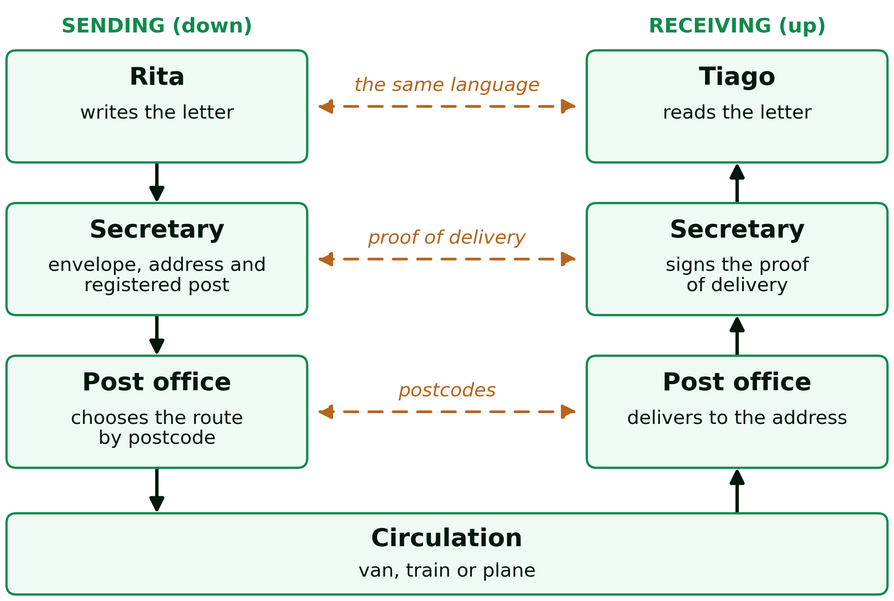
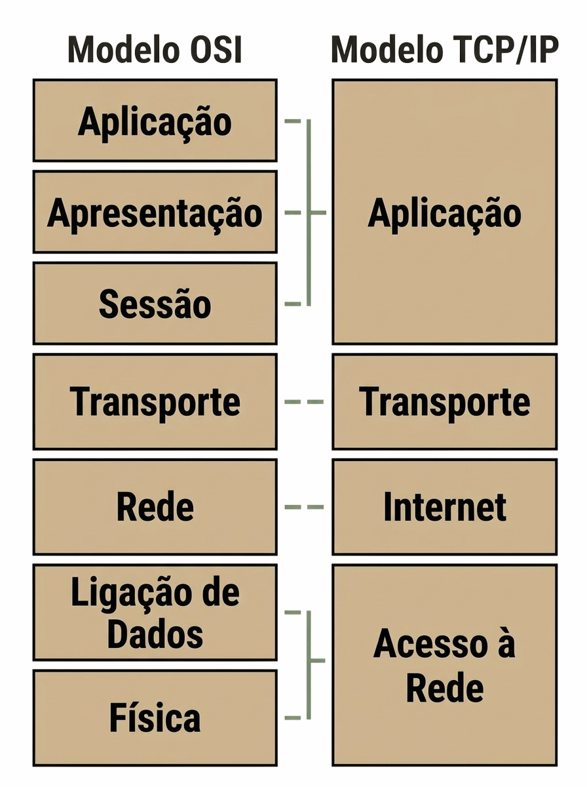
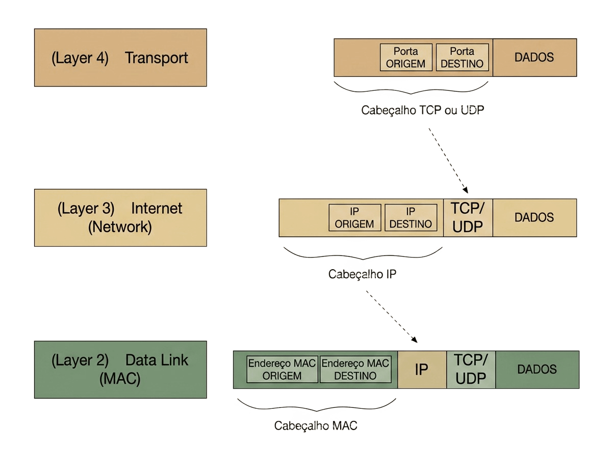
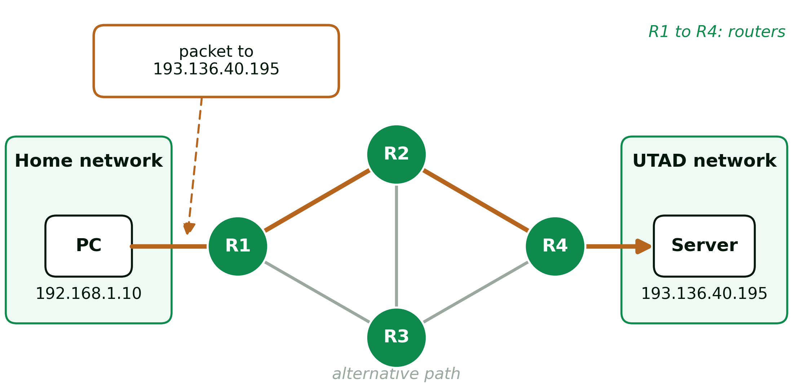
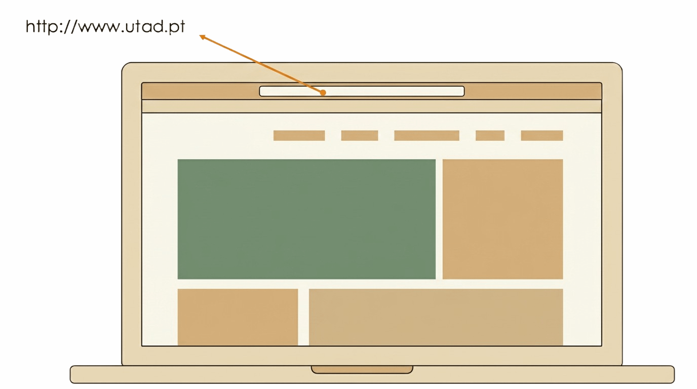

```{=html}
<div class="hero hero-chapter" style="background-image: linear-gradient(to top, rgba(4,23,12,0.88) 0%, rgba(4,23,12,0.6) 20%, rgba(4,23,12,0.15) 45%, rgba(4,23,12,0) 65%), url('../assets/images/heroes/cap06.jpg');">
  <div class="hero-badge">Chapter 6</div>
  <h1>Communication Models and Networks</h1>
</div>
```

## From PHP to the Network {#sec-06-context-en}

While developing the Contraponto site, Tiago works only on the server side: he keeps the article catalogue in an *array*, filters it by category with an `if` inside a `foreach`, and adds the same header and footer to every page with `include`. He tests everything on `localhost`, that is, with the *browser* and the server on the same computer.

Rita, the magazine's editor, then asks a simple question: "When a reader in Bragança types in the Contraponto address, how does the page get to them?". It is already known that the *browser* sends a request and the server returns HTML. This chapter deals with what happens **between** the two.

## What Does a Web Programmer Gain from Understanding the Network? {#sec-06-why-network-en}

There are three reasons for a web programmer to understand the path each request travels:

1. **PHP only reaches the reader through the network.** The code may be correct, but the page only appears if the request reaches the server and the response comes back.
2. **To understand errors.** "Server not found" is a naming problem. "Connection refused" is a port problem. Neither is a PHP error: knowing where the problem lies avoids looking for it in the wrong place.
3. **To publish the site.** Putting Contraponto *online* requires a domain name, an IP address and ports 80 and 443.

When Rita calls to say "the site won't open", Tiago has to be able to answer: is the problem in the PHP or on the way to the server?

## Why Organise Communication into Layers? {#sec-06-why-layers-en}

For a *browser* request to reach the Contraponto server, several operations are needed, each carried out by a different part of the system. For example:

1. **Finding the server:** discovering the address from the name (name resolution);
2. **Guaranteeing a reliable connection:** confirming that nothing is lost and that everything arrives in the right order;
3. **Determining the path:** choosing where the data goes, from network to network (routing);
4. **Converting the data into signals:** electrical, light or radio, handled by the network card.

Only the first one starts in the *browser*. The others are carried out by the operating system, by *routers* and by the network card. This leaves a question: how do devices from different manufacturers, spread all over the world, all carry out these operations in the same way?

### What is a Protocol? {#sec-06-protocol-en}

The answer lies in protocols. A **protocol** is a set of rules agreed between two devices that communicate at a distance. It defines:

- the **format** of the messages;
- the **order** in which they are exchanged;
- what to do when **something goes wrong**.

It works as a **contract** between the two devices.

No protocol handles the whole sending of a message on its own. Several are used, each responsible for one of the operations above, stacked on top of each other: **the ones above use the ones below**. This set is called a **protocol stack**. Each level of the stack is called a **layer**; hence the name **layered architecture**. Each layer uses the services of the layer below and offers its own services to the layer above.

### Example: the Layers in Sending a Letter {#sec-06-letter-en}

Sending a letter by post is organised in the same way. Rita wants to send a letter to Tiago. She writes it and hands it to her secretary, who puts it in an envelope, writes the address and sends it by registered post, with proof of delivery. The post office chooses the route by postcode, and the letter travels by van, train or plane. On Tiago's side, the path is reversed: the post office delivers the letter to the address, Tiago's secretary signs the proof of delivery and hands him the letter, and Tiago reads it (@fig-06-letter-en).

{#fig-06-letter-en width="85%"}

In this example, each layer carries out one of the four operations described above:

1. **Finding the server:** equivalent to Rita looking up Tiago's address in her address book;
2. **Reliable connection:** equivalent to the secretary asking for proof of delivery and, if it does not arrive, sending the letter again;
3. **Path:** the post office chooses it using maps and postcodes;
4. **Signals:** the circulation itself; the van, the train or the plane carry the letter from one point to the other.

Rita does not know whether the letter went by van or by plane, and the driver never reads it. If the post office replaces the van with a drone, neither Rita, nor the secretaries, nor Tiago have anything to do with it. **This independence is what gives layers their value:** each layer can be improved or replaced without touching the others, as long as it keeps providing the same service to the layer above.

### Service and Protocol {#sec-06-service-protocol-en}

The letter figure shows two kinds of relationship, which should be told apart:

- **Protocol:** rules between the **same layer** on two different devices (the so-called **peer layers**). The two peer layers follow the same rules and understand each other **at a distance**. In @fig-06-protocol-service-en, these are the horizontal arrows.
- **Service:** what a layer offers to the **layer immediately above**, within the **same device**. The layer above uses that service without needing to know how it works inside. In @fig-06-protocol-service-en, these are the vertical arrows.

In short, a protocol acts remotely and a service acts locally. In the letter, Rita's secretary **uses the service** of the post office: she hands over the letter and does not care how it gets there. But she **follows a protocol** with Tiago's secretary, without ever speaking to her: she asks for proof of delivery, and the other secretary knows she has to sign it and send it back, because that is the agreed rule.

{#fig-06-protocol-service-en width="70%"}

## The Two Models: OSI and TCP/IP {#sec-06-osi-tcpip-en}

Historically, two reference models emerged for organising communication into layers, with different origins.

### The OSI Model {#sec-06-osi-en}

The **OSI** (*Open Systems Interconnection*) model is a formal model with **seven layers**, created by the ISO (*International Organization for Standardization*), the international standards body. From top (7) to bottom (1):

- **Application (7):** where the protocols used by the user's programs work (HTTP, SMTP, FTP);
- **Presentation (6):** puts the data in a format both sides understand (encoding, compression, encryption);
- **Session (5):** opens, maintains and closes the conversation between the two sides;
- **Transport (4):** delivers the data to the right program, with or without a delivery guarantee (TCP, UDP);
- **Network (3):** chooses the path between different networks (IP);
- **Data Link (2):** delivers the data to another device on the same local network (Ethernet, Wi-Fi);
- **Physical (1):** turns the bits into electrical, light or radio signals.

OSI is a ***de jure*** standard (Latin for "by law"): it was formally defined by a standards body before it was in widespread use.

### The TCP/IP Model {#sec-06-tcpip-en}

The **TCP/IP** model was born from practice, in ARPANET, the network created in the 1960s by the US Department of Defense that gave rise to the Internet. It is simpler than OSI: it has only **four layers**.

- **Application:** the protocols programs use directly (HTTP, SMTP, FTP, DNS);
- **Transport:** delivers the data to the right program on the remote computer, using **TCP** (*Transmission Control Protocol*), which confirms that all the data sent reaches its destination, or **UDP** (*User Datagram Protocol*), faster but without that confirmation;
- **Network (or Internet):** routes the data between different networks, with **IP** (*Internet Protocol*). It is called "Internet" because it is the layer that links networks together (the name comes from *internetwork*);
- **Network Access:** delivers the data on the local network and transmits it over the physical medium (Ethernet, Wi-Fi).

TCP/IP is a ***de facto*** standard ("in practice"): it established itself through widespread use, before any formal standardisation. It is the model the Internet uses.

### OSI and TCP/IP Side by Side {#sec-06-side-by-side-en}

@tbl-06-osi-tcpip-en summarises the differences between the two models.

|                 | OSI model                | TCP/IP model                 |
|-----------------|--------------------------|------------------------------|
| Layers          | 7                        | 4                            |
| Origin          | ISO, standards body      | ARPANET, born from practice  |
| Type of standard | *de jure*               | *de facto*                   |
| Use today       | reference and teaching   | what the Internet uses       |

: The differences between the OSI and TCP/IP models. {#tbl-06-osi-tcpip-en}

@fig-06-osi-model-en shows the correspondence: the top three OSI layers merge into the TCP/IP **Application** layer, and the bottom two into **Network Access**. OSI is still taught because it separates the responsibilities of each layer more clearly. A web programmer is mainly interested in three TCP/IP layers: application, where HTTP works; transport, with TCP; and network, with IP.

{#fig-06-osi-model-en width="45%"}

::: {.callout-note}
To see which other real protocols run in each layer, and the more precise formalism behind the distinction between service and protocol, see @sec-apD-protocols-layer-en and @sec-apD-services-protocols-en.
:::

## The Path of the Data: Encapsulation {#sec-06-encapsulation-en}

@fig-06-nic-transmission-en shows the path that the data of a request travels inside the computer, from top to bottom:

1. The *browser* (the **DADOS** rectangle, "data") translates its requests (for example, for a page) into a text message, according to the rules of a protocol called HTTP;
2. It hands that message to the ***socket***: the connection point between the program and the layers below;
3. The message goes down the transport, network and link layers, and each one adds a header with its own information, according to the rules of its protocol;
4. It reaches the **network card** (NIC, *Network Interface Controller*), which converts it into electrical or radio signals.

{#fig-06-nic-transmission-en width="55%"}

::: {.callout-note}
Do not confuse the **application layer** (a layer of the TCP/IP model) with the **application** (the program the user uses, such as the *browser*).
:::

On the way down, each layer adds a **header** to the data: a block with the information that the peer layer, on the other device, will need to do its job. This process is called **encapsulation**:

1. **Application Layer:** produces the data (the HTTP message);
2. **Transport Layer:** adds the TCP header, with the **port** numbers, which identify the program sending and the program receiving the data;
3. **Network Layer:** adds the IP header, with the **IP addresses**, which identify the computer;
4. **Network Access Layer:**
   1. **Link Sublayer:** adds the MAC header, with the **MAC addresses**, which identify the network card;
   2. **Physical Sublayer:** converts everything into electrical, optical or radio signals.

At the receiver, each layer removes and processes its own header, in reverse order. It is like a letter placed in an envelope, which goes inside another envelope, which in turn goes inside another: each layer adds its own envelope, with its own address, and at the destination the envelopes are opened in reverse order.

{#fig-06-headers-en width="85%"}

### The Transport Layer: TCP and Ports {#sec-06-tcp-en}

The transport layer receives the HTTP message through the *socket* and adds a TCP header with two **ports**:

- **source port:** identifies the sending program (for example, port 52344, chosen by the operating system for the *browser*);
- **destination port:** identifies the receiving program (port 80, the web server's).

A port is a number between 0 and 65535 that identifies a **program** within the computer, not the computer.

To guarantee that everything arrives, TCP:

1. Splits the message into numbered pieces, called **segments**, labels them with their headers and sends them to the network layer;
2. On the other side, the receiver's transport layer acknowledges each segment it receives;
3. Anything not acknowledged within a given period of time is sent again;
4. At the destination, the segments are put back in order by number, because they may arrive out of order, depending on the path taken through the network.

Ports 0 to 1023, called ***well-known ports***, are reserved for well-known services. That way, any *browser* knows, without asking, on which port to find a web server. @tbl-06-common-ports-en shows some of the most used.

| Port | Protocol | Service |
|------|----------|---------|
| 80   | HTTP     | Web pages |
| 443  | HTTPS    | Encrypted web pages (the padlock in the *browser*) |
| 21   | FTP      | File transfer |
| 25   | SMTP     | Sending email |
| 53   | DNS      | Translating names into addresses |

: *Well-known* ports of some common protocols. {#tbl-06-common-ports-en}

When the address typed into the *browser* does not specify a port, the protocol's port is used: `http://www.utad.pt` is the same as `http://www.utad.pt:80`.

::: {.callout-note}
The exact structure of the TCP header, and the mechanisms that guarantee reliability, are covered in depth in @sec-apD-tcp-en.
:::

### The Network Layer: IP Addresses {#sec-06-ip-en}

The network layer adds an IP header with the **source and destination IP addresses**. An IP address identifies a **computer**, even if it is on a different network.

- **IPv4:** four numbers from 0 to 255, separated by dots, as in `192.168.24.36`;
- **IPv6:** the most recent version, created because IPv4 addresses (around 4.3 billion) ran out. It is written in groups separated by colons, as in `2001:db8::1`.

A computer has one IP address per network card. A laptop connected by Wi-Fi and by cable has two.

::: {.callout-note}
The full structure of the IP header is covered in depth in @sec-apD-ip-en.
:::

### The Link Layer: Ethernet and MAC Addresses {#sec-06-ethernet-en}

The link layer delivers the packet to a machine **on the same local network**, adding the source and destination **MAC addresses** (*Medium Access Control*) and forming a *frame*, typically according to the IEEE 802.3 standard (Ethernet) or its Wi-Fi equivalent. The MAC address:

- has the format `XX:XX:XX:XX:XX:XX`, as in `00:1A:2B:3C:4D:5E`;
- is assigned by the **manufacturer of the network card**;
- was designed to be unique worldwide;
- is only valid **within the same local network**.

For privacy reasons, many recent phones and computers do not show the Wi-Fi network the manufacturer's address, but a **private MAC address**, generated by the device itself and different for each network. This is the case of the iPhone in @fig-06-iphone-example-en.

::: {.callout-note}
The full structure of an Ethernet frame is covered in depth in @sec-apD-ethernet-en.
:::

### The Physical Medium {#sec-06-physical-en}

Finally, in the physical layer, the bits are converted into electrical signals, light pulses (optical fibre) or radio waves (Wi-Fi), and transmitted over the corresponding physical channel. On the receiver's side, the process happens in reverse, layer by layer, until only the application's original data remains. The full path, in both directions, is covered in depth in @sec-apD-reception-en and @sec-apD-overview-en.

### The Three Levels of Addressing {#sec-06-three-levels-en}

Two applications communicate through **three addresses**, each identifying something different (@tbl-06-layer-addresses-en).

| Layer     | Protocol | Source and destination | Identifies        |
|-----------|----------|------------------------|-------------------|
| Transport | TCP      | application ports      | the application   |
| Network   | IP       | computers' IPs         | the computer      |
| Link      | Ethernet | MAC addresses          | the network card  |

: The three levels of addressing. {#tbl-06-layer-addresses-en}

If any one of these three addresses is missing, the communication cannot be completed.

These addresses are not theoretical abstractions: any device connected to a network has a MAC address and an IP address, visible in its network settings. @fig-06-iphone-example-en shows the Wi-Fi settings of an iPhone connected to the `eduroam` network:

- **Wi-Fi Address:** the MAC address, in this case a private address;
- **IP Address:** `192.168.155.39`;
- **Subnet Mask:** indicates which part of the IP address identifies the local network and which part identifies the device within it;
- **Router:** `192.168.155.254`, the device to which the iPhone sends everything destined for other networks.

The IP address was assigned automatically by the network, through **DHCP** (*Dynamic Host Configuration Protocol*), without the user having to configure it.

{#fig-06-iphone-example-en width="35%"}

## Routing {#sec-06-routing-en}

The Internet is a **network of networks**, linked by *routers*. It is this link between networks that allows, for example, a Contraponto reader at home to reach the magazine's server, which is on a completely different network.

Two tasks should be told apart:

- **Routing**: choosing the path the packet follows, network by network, to its destination (@fig-06-routing-en);
- **Forwarding**: what each *router* does with each packet that arrives (@fig-06-forwarding-en).

{#fig-06-routing-en width="85%"}

To forward a packet, a *router*:

1. Reads the packet's **destination IP address**;
2. Looks up its **routing table**, with rules that associate each possible destination with the exit the packet should take;
3. Forwards the packet through that exit, to the **next network**.

Network by network, the packet reaches its destination.

{#fig-06-forwarding-en width="80%"}

A typical example: someone at home types a search into Google. The packet's destination IP is that of Google's servers. The home *router* recognises that this IP does not belong to the local network and forwards the packet to the Internet provider's network; from *router* to *router*, the packet eventually reaches the destination server.

A *router* should also be told apart from a *switch*:

- ***switch***: links devices on the **same local network**, passing frames on based on **MAC** addresses (this process is called **switching**);
- ***router***: links **different networks**, routing packets based on **IP** addresses.

That is why a request to a server outside the local network always goes through at least one *router*.

## Ports, Addresses and URLs {#sec-06-ports-addresses-en}

A URL such as `https://www.utad.pt/index.php` combines several pieces of information:

- **Protocol** (`https`): defines how to communicate. The "s" after `http` indicates that the HTTP connection is secure, that is, encrypted, and uses port 443;
- **Server name** (`www.utad.pt`): identifies the destination server, through DNS;
- **Port** (optional): by default, 80 for HTTP and 443 for HTTPS;
- **Resource** (optional, `index.php`): the path or name of the page or file.

So `http://www.utad.pt` and `http://www.utad.pt:80` are equivalent.

{#fig-06-pc-url-en width="55%"}

The network only understands IP addresses, not domain names. It is DNS that converts the name into the IP address needed.

## The Domain Name System (DNS) {#sec-06-dns-en}

**DNS** (*Domain Name System*) translates domain names, such as `www.utad.pt`, which are easy for people to remember, into the corresponding IP address. From the user's point of view, it works like this:

1. The *browser* asks the local DNS server for the IP of a name;
2. DNS replies with the IP address;
3. The *browser* uses that IP in the following packets.

DNS is a **hierarchical and distributed** system, organised into domains and subdomains (@fig-06-dns-en). A server may not know the IP of a name, but it knows whom to ask. Name resolution (that is, turning names into IP addresses) is a mandatory step when a site is accessed for the first time.

{#fig-06-dns-en width="70%"}

Resolving `www.utad.pt` follows a chain of questions between DNS servers (@fig-06-dns-resolution-en):

1. The *browser* asks the local DNS for the IP of `www.utad.pt`;
2. The local DNS asks the root server (`ROOT`): "Who manages `.pt`?";
3. The root server points to the server of the `.pt` top-level domain;
4. The local DNS asks the `.pt` server: "Who manages `utad.pt`?";
5. The `.pt` server points to the `utad.pt` server;
6. The local DNS asks the `utad.pt` server: "What is the IP of `www.utad.pt`?";
7. The `utad.pt` server replies to the local DNS: `193.136.40.195`;
8. The local DNS returns the IP to the *browser*.

Only after the name has been resolved can the HTTP request be sent.

{#fig-06-dns-resolution-en width="90%"}

## Summary: the Complete Path of a Web Request {#sec-06-summary-en}

Before the reader sees the Contraponto page, all of this happens automatically:

1. **URL → DNS:** the domain name is resolved into an IP address;
2. **Application → TCP:** the HTTP data is encapsulated with the source and destination ports;
3. **TCP → IP:** the segment is encapsulated with the IP addresses;
4. **IP → Ethernet:** the packet is encapsulated with the MAC addresses, in a frame;
5. **Physical:** the frame is converted into electrical, light or radio signals;
6. **Routing:** the packet travels across the Internet, from *router* to *router*;
7. **Reception:** the server decapsulates the data layer by layer and processes the HTTP request.

## References {#sec-06-references-en .unnumbered}

::: {#refs}
:::
